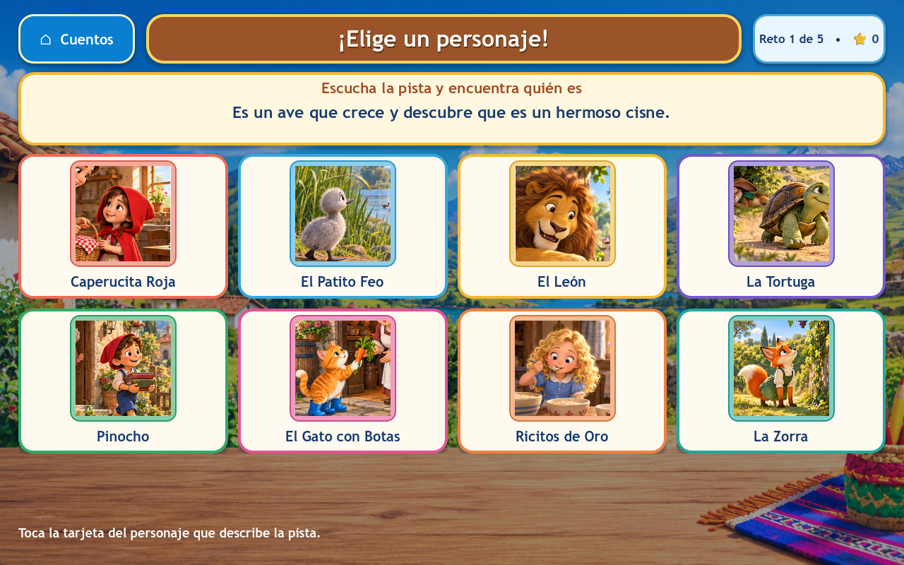
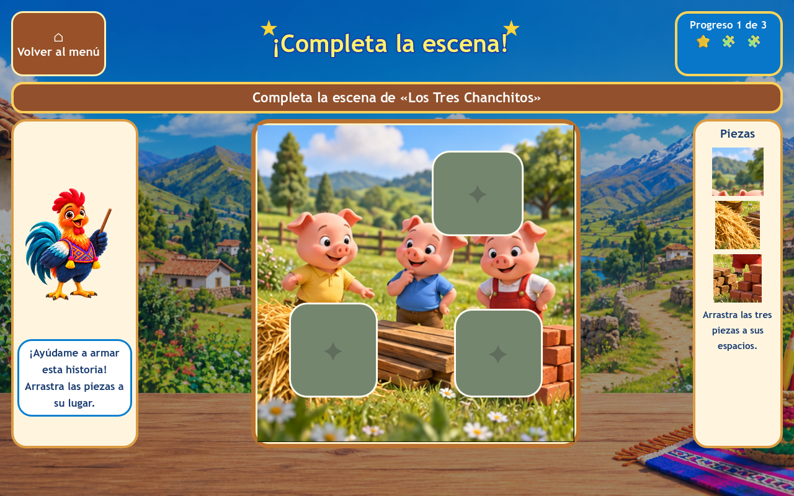
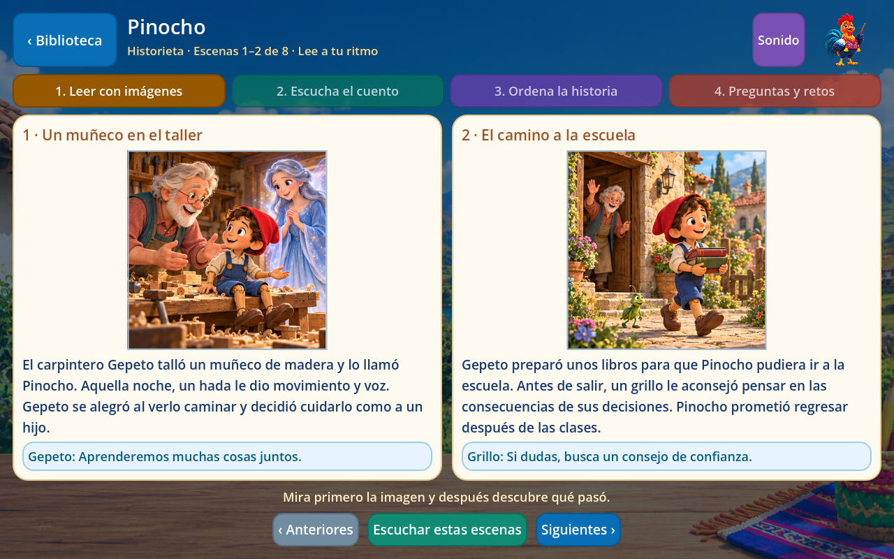
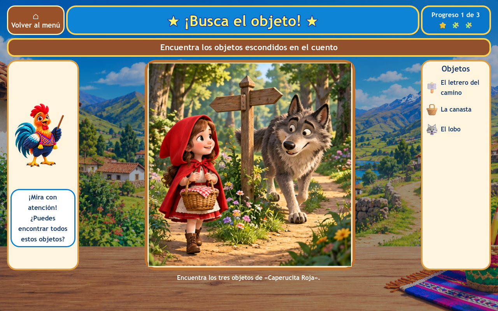
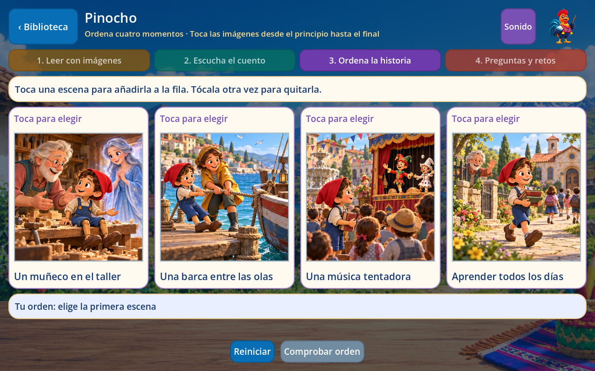
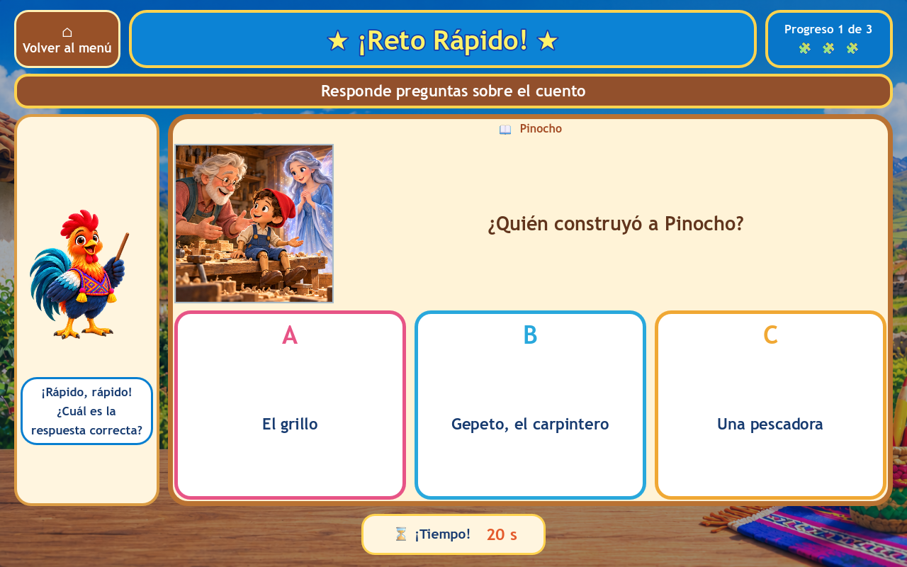

# Coherencia visual de Cuentos

Esta revisión se limita al arte y a los ajustes necesarios para mostrarlo correctamente. Conserva las actividades que añadió el compañero, sus rondas, las preguntas, las puntuaciones y las voces. No se reconstruyeron los juegos.

## Qué se corrigió

| Área | Cambio visual |
| --- | --- |
| Elegir personaje | Las ocho tarjetas usan recortes de los personajes de las ilustraciones de sus propios cuentos. Se sustituyeron las portadas vectoriales antiguas y se unificó el formato cuadrado. |
| Completa la escena | Se muestra la escena completa y el marco visible se adapta a su proporción. Las piezas se calculan sobre la ilustración original y al colocarse cubren exactamente el hueco, sin márgenes que rompan la imagen. |
| Busca el objeto | Se mantienen los tres escenarios y los nueve objetivos. Se ajustaron las zonas del letrero, la canasta, el lobo, los juncos, el patito y la roca para coincidir con las ilustraciones, sin superponerse. |
| Reto rápido | Cada pregunta muestra una única escena de referencia del cuento correspondiente. Las respuestas siguen siendo tres; se retiró la selección de portadas de otros cuentos por palabras sueltas. |
| Pinocho | Ocho ilustraciones nuevas con el mismo acabado de cuento 3D que el resto. Mantienen el taller, la escuela, el teatro, la mentira, el regreso, la barca, el reencuentro y la vuelta a clase. |
| Fondo | Los cuatro juegos inferiores reutilizan el paisaje andino de los otros recorridos de Cuentos. |
| Biblioteca y cuatro recorridos | Portadas, lectura, narración, orden y preguntas muestran la ilustración completa, sin zoom de relleno ni deformación. Los marcos de las tarjetas se ajustan a la imagen y las páginas conservan su composición de lectura. |

La diferencia de Pinocho estaba en el estilo de las ilustraciones: el anterior era vectorial plano. Se mejoró ese aspecto, no se añadió una animación de vídeo ni una sincronización de boca. Carmelo conserva su animación y su voz.

En el reto rápido se corrigieron dos problemas de presentación: una respuesta larga hacía crecer el botón fuera de la ventana y los controles del resultado podían quedar debajo de la pantalla. La respuesta se muestra ahora en el área de la pregunta y el resultado dispone del espacio de la partida terminada. No cambian el tiempo de las rondas ni la forma de puntuar.

## Arte y mantenimiento

El único atlas generado nuevo es [pinocho-v2.png](../assets/stories/pinocho-v2.png). Se utilizó **image_gen.imagegen**, con [Caperucita](../assets/stories/caperucita_roja.png) como referencia de estilo. Los [prompts exactos](reference/stories/art-refresh/prompts.json) y la [procedencia y firma del PNG](reference/stories/art-refresh/provenance.json) quedan guardados.

El atlas anterior de Pinocho y su SVG se conservan. Los otros quince cuentos reutilizan sus imágenes previas.

Los retratos de las ocho tarjetas y las sustituciones de atlas se editan en `data/stories/visuals.json`. `scripts/stories/story_art.gd` prepara pequeñas texturas de hasta 256 píxeles para las tarjetas, conservando en memoria esas miniaturas en lugar de ocho atlas completos. `scripts/stories/story_image.gd` muestra las escenas completas, ajusta su escala de forma proporcional y dibuja el borde alrededor de la imagen realmente visible.

Se eliminó el recorte automático que rellenaba los marcos anchos y dejaba fuera partes de las escenas. En los tableros interactivos se usa toda la ilustración original, con marcos proporcionales, y las coordenadas de las piezas y de los objetos siguen referidas a ella. La adaptación al tamaño no cambia el contenido visible ni la correspondencia de las piezas colocadas.

Para cambiar un atlas:

1. Añadir el PNG con ocho escenas en cuadrícula de cuatro columnas y dos filas.
2. Registrar su ruta en `data/stories/visuals.json`.
3. Ejecutar `python tools/prepare_story_library.py`.
4. Revisar los recortes, las zonas de búsqueda y las imágenes con el juego abierto.

No hace falta regenerar audio si no cambian los textos. La preparación del catálogo respeta las sustituciones visuales. Para el resto del equipo, las imágenes ya están incluidas y se reproducen sin conexión.

## Comprobaciones

La auditoría verificó que solo cambian las referencias de imagen de Pinocho en el catálogo. Sus textos, diálogos, audios, tiempos, preguntas, respuestas, escenas de evidencia, orden e identificadores siguen iguales. Los ajustes posteriores al tamaño de los marcos se limitan a la presentación de Cuentos, sus recortes y sus pruebas. Lenguaje, Matemáticas, Números y Geometría mantienen su contenido.

La validación completa pasó con Godot 4.7.2 en Windows: **5.230 comprobaciones de Godot**, cuatro pruebas de Python y auditoría de recursos. Las 375 comprobaciones de arte cubren miniaturas, imágenes completas y proporcionales, ausencia de recorte en tableros y retos, correspondencia de piezas y objetivos, las 64 preguntas del reto, arrastre real del rompecabezas, clics en los nueve objetivos, resultados y conservación del progreso.

La revisión con renderizado real recorrió **413 composiciones a 1280 × 800 y otras 413 a 960 × 600**, sin botones fuera de vista. Incluye preguntas, respuestas incorrectas, resultados, todas las páginas de lectura y narración de los dieciséis cuentos, y sus modos de orden y preguntas. Se comprobó también el llenado de los marcos de la biblioteca. La comprobación en una tablet Android física continúa pendiente.

## Capturas reales

| Personajes y lectura | Juegos |
| --- | --- |
|  |  |
|  |  |
|  |  |

