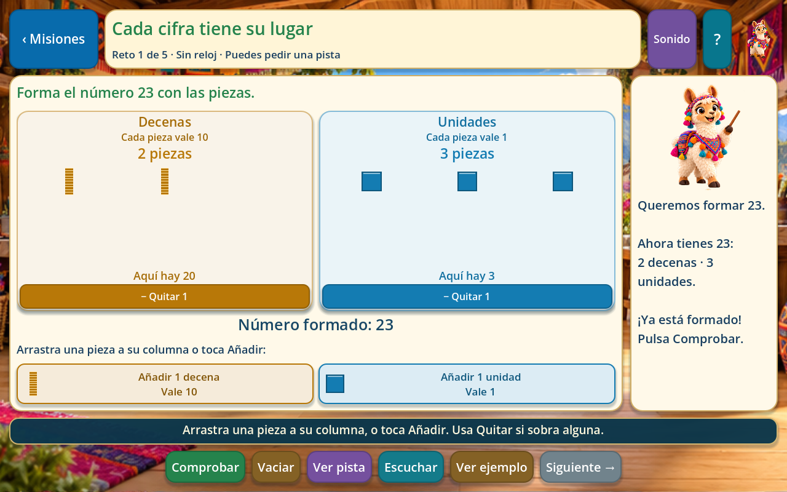

# Corrección de las actividades de una a cuatro cifras

El problema observado era real: los bloques mostraban la cantidad elegida con una botonera del 0 al 9, pero no se podían arrastrar. Además, el ejemplo de construcción se repetía en misiones cuyo objetivo era leer, ordenar o buscar vecinos. Eso hacía confusa la relación entre las instrucciones, los números y las acciones disponibles.

Ahora se construye directamente con **piezas de valor posicional**. Un cubito vale 1, una barra 10, una placa 100 y un cubo grande 1000. Se arrastran desde la bandeja a su columna, o se añaden tocando su botón. Se pueden quitar con Quitar o devolverlas a la bandeja. Las piezas y los canjes tienen movimiento visible; la fila de cifras sueltas se retiró de la interfaz.

Por ejemplo, para formar **23** se ponen dos barras en Decenas y tres cubitos en Unidades. La pantalla muestra cuánto aporta cada columna y el número completo que se va formando. Si una pieza cae en una columna de otro valor, se rechaza; una unidad no se transforma accidentalmente en una decena. Diez piezas pueden canjearse por una de la columna izquierda conservando el total.

Las columnas usan nombres completos. Las consignas habladas y escritas coinciden con la acción. Si una construcción es incorrecta, se indica qué columna tiene piezas de más o de menos. Los ejemplos iniciales corresponden al objetivo de la misión: construir, leer, componer, identificar valor, encontrar vecinos u ordenar.

Se mantienen las veinte misiones, los cien retos, los identificadores y el progreso existente. **Si aparece Continuar, el botón Ver ejemplo permite repasar la nueva explicación sin perder la construcción o las respuestas guardadas.**

La validación incluye las veinte misiones completas, lectura de los 228 audios locales, guardados parciales y canjes encadenados. Una prueba adicional de 62 comprobaciones usa eventos reales de entrada para arrastrar, tocar, quitar y devolver piezas en los cuatro tamaños de número. También comprueba que un arrastre rechazado no pierda la pieza. Se conserva la revisión visual en dos tamaños de ventana.

La guía completa y el reparto de archivos están en [Actividades de Números](NUMEROS_ACTIVIDADES.md). Esta corrección no modifica Matemáticas, Geometría, Lenguaje ni Cuentos.
