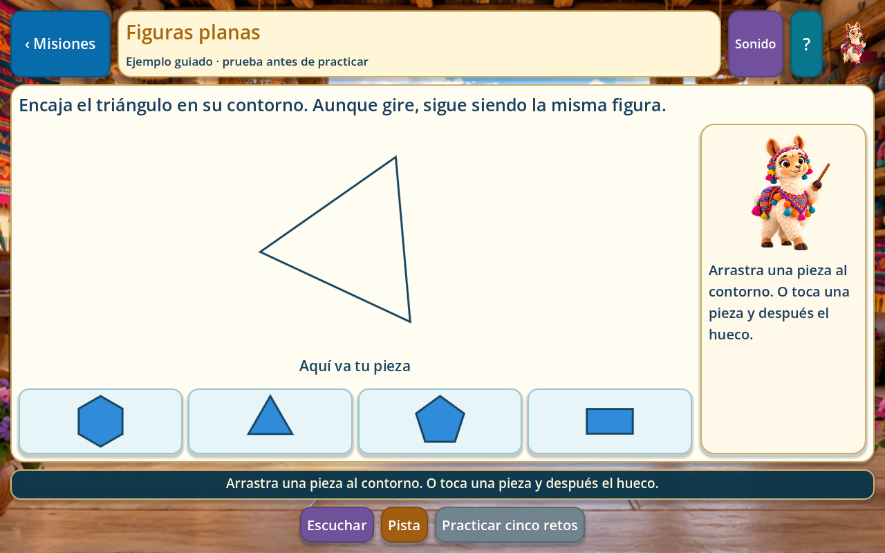
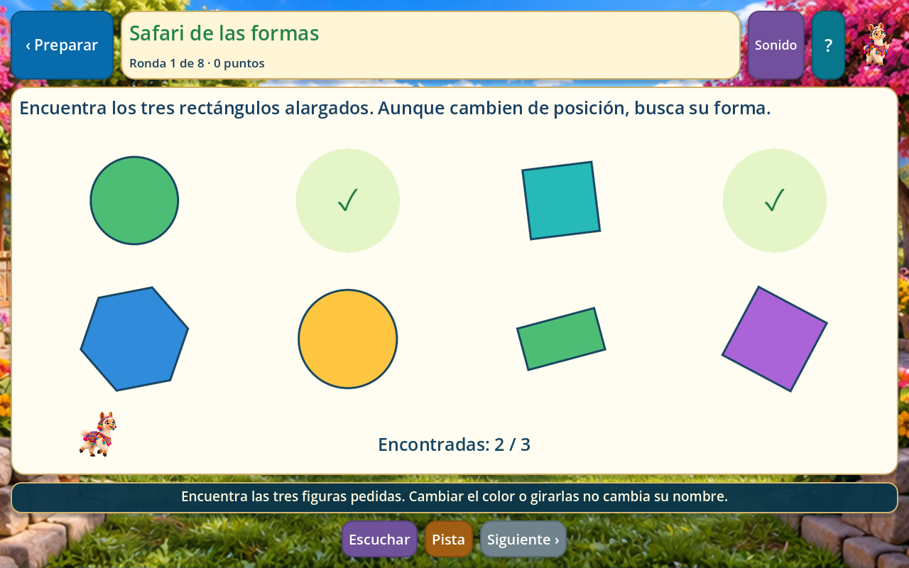
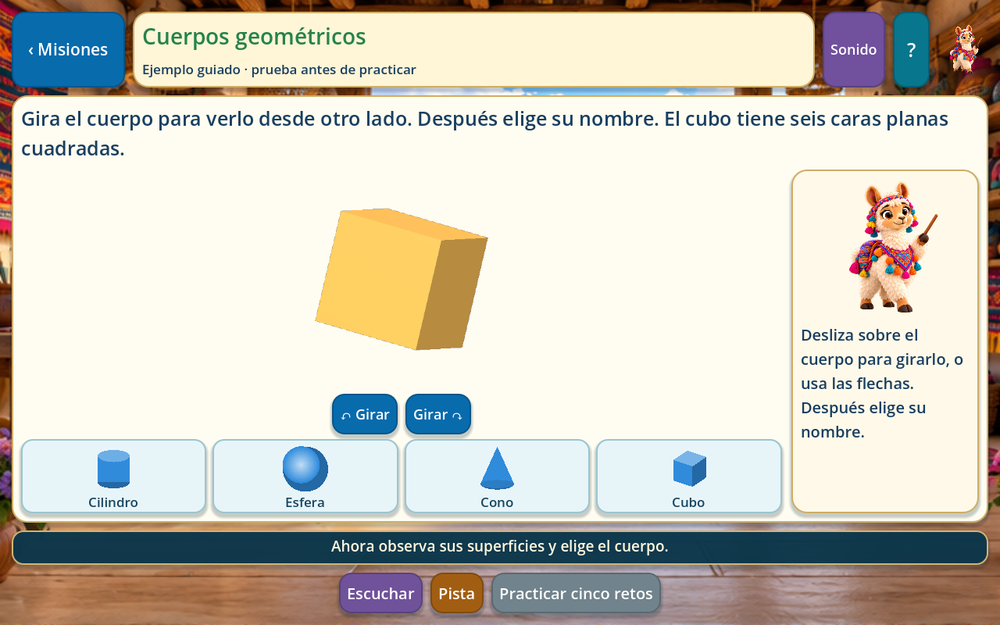
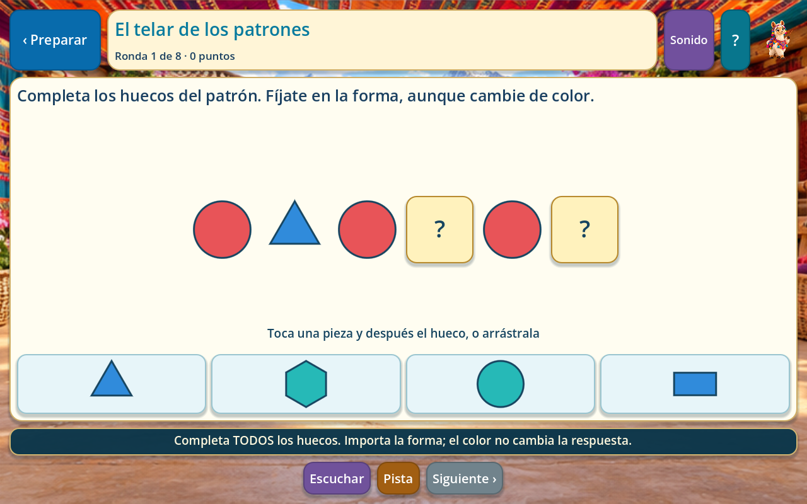
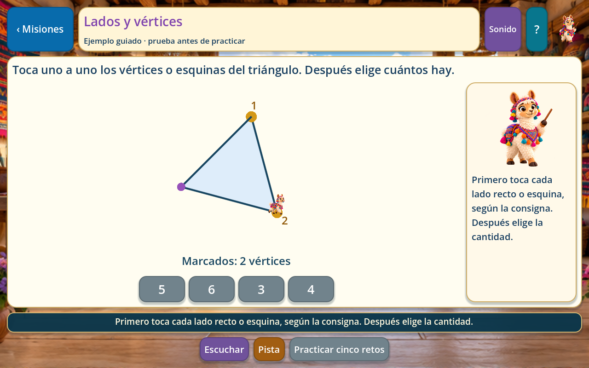
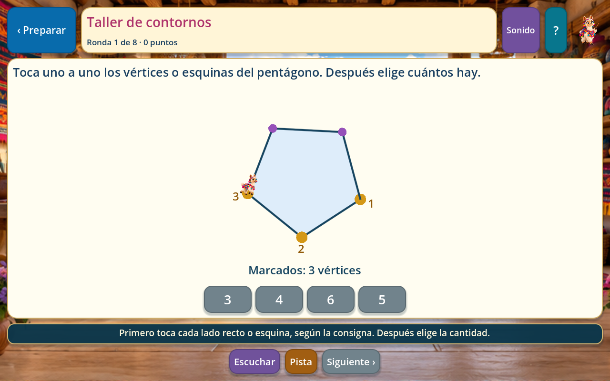
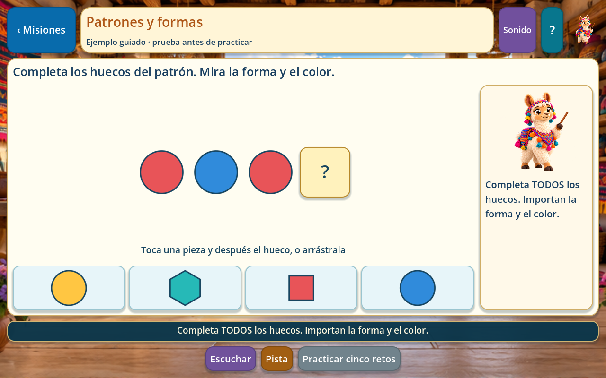
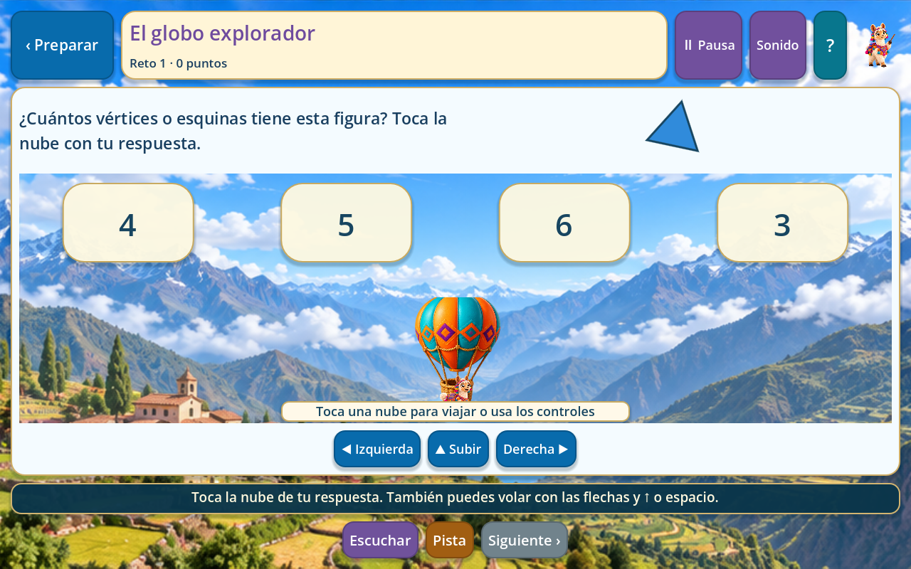

# Geometría: explorar, comprender y jugar

Las ocho tarjetas del menú ya abren actividades dentro de Godot. Se mantiene la llama de Matemáticas y Números, con la misma voz peruana y ajustes de sonido. Las ilustraciones nuevas se incluyen en el proyecto y la geometría que se cuenta se dibuja con medidas exactas. Todo el recorrido funciona sin navegador ni conexión.

## Las ocho secciones

| Tarjeta | Qué hace el niño | Qué se trabaja |
| --- | --- | --- |
| Figuras planas | Arrastra una pieza al contorno, o toca pieza y hueco. Reconoce figuras giradas y de distintos colores. | Círculo, triángulo, cuadrado, rectángulo alargado, pentágono y hexágono; sus propiedades permanecen al girar. |
| Cuerpos geométricos | Gira un modelo 3D con el dedo, el ratón o las flechas de giro. Elige su nombre y lo relaciona con objetos. | Cubo, esfera, cilindro y cono; caras planas, bases y superficies curvas. |
| Lados y vértices | Toca cada lado recto o esquina. Cada parte queda marcada una sola vez; después elige la cantidad. | Diferencia entre lado y vértice; conteo sin repetir. El círculo tiene cero lados rectos. |
| Patrones y formas | Completa huecos con piezas. La consigna indica si importa solo la forma o también el color. | Reglas AB, AAB y ABC, posiciones intermedias y alternancia de colores. |
| Busca la figura | Encuentra tres figuras en un safari de ocho piezas; la llama se desplaza para acompañarlo. | Reconocimiento pese a cambios de tamaño, color y posición. |
| Arma el patrón | Completa dos o tres huecos del telar, arrastrando o tocando piezas. | Mantener la misma regla en varios lugares de una secuencia. |
| Cuenta lados | Marca lados o vértices mientras la llama recorre el contorno; responde después de explorar. | Relación entre figura, partes y cantidad. |
| Reto rápido | Viaja en globo hacia una respuesta. Toca su nube para ir automáticamente o conduce con los controles. | Recuperación y aplicación de nombres, propiedades, conteos y patrones. |

Las cuatro tarjetas centrales tienen **cinco misiones cada una**: **20 ejemplos interactivos y 100 retos**. El ejemplo corresponde al tipo de reto de esa misión. No da puntos y puede revisarse durante la práctica sin perder las respuestas ni las partes marcadas.

Los cuatro juegos inferiores ofrecen dos niveles. Safari, telar y contornos tienen ocho rondas por nivel: **48 rondas preparadas**. El globo utiliza **100 adaptaciones de los retos**, con instrucciones propias de vuelo; son variaciones para practicar los mismos conceptos, no cien objetivos educativos diferentes. Cada viaje sin reloj selecciona ocho preguntas distintas.

## Controles y ayudas

- Figuras y patrones: arrastrar una pieza al hueco, o tocar la pieza y después el hueco. La pieza elegida queda resaltada. Una pieza incorrecta no desaparece ni completa el reto.
- Cuerpos: deslizar horizontal y verticalmente sobre el modelo, o usar los botones de giro. En el ejemplo se pide girar antes de contestar. Las prácticas permiten reconocerlo sin forzar otra rotación.
- Contornos: tocar o recorrer cada segmento recto, o tocar cada esquina si se piden vértices. Los extremos no cuentan como lados y las marcas repetidas no se suman.
- Globo: tocar una respuesta para viajar automáticamente; también flechas izquierda/derecha o A/D y subir con ↑ o Espacio. En pantalla hay tres controles y se pueden mantener dos dedos independientes.
- Escuchar, Pista, Ver ejemplo, Sonido y Ayuda están disponibles según el modo. Escape cierra la ayuda o regresa. P pausa el vuelo.

El vuelo empieza **sin reloj**. Opcionalmente puede durar 90 o 120 segundos. El reloj espera durante la narración, las ayudas, la pausa y la revisión de una respuesta correcta. Al perder el foco de la aplicación, el viaje se pausa y libera los controles retenidos. Un error devuelve el globo y permite reintentar; no quita vidas.

## Precisión de las explicaciones

El círculo tiene un borde curvo, sin lados rectos ni vértices. No se cuenta su borde como un lado de polígono.

Un cuadrado también es un rectángulo. Para que las opciones no se contradigan, los retos llaman **rectángulo alargado** al que tiene dos lados largos y dos cortos. Girar un cuadrado no lo convierte en otra figura.

La esfera no tiene caras planas; el cilindro tiene dos bases circulares y una superficie lateral curva; el cono tiene una base circular, superficie curva y punta. Se evita una pregunta ambigua sobre cuántas “caras” curvas tienen.

Los contornos y polígonos son geometría nativa exacta. Los cuatro cuerpos grandes son mallas 3D reales y se renderizan en un SubViewport independiente. Las ilustraciones de pelota, lata y gorro sirven para relacionar objetos que **se parecen** a los cuerpos; no se usan para medir caras o contar lados. Referencia técnica: [Viewports de Godot](https://docs.godotengine.org/en/stable/tutorials/rendering/viewports.html).

## Progreso y puntuación

Se conserva `user://progreso_geometria.cfg`, incluidos identificadores y datos anteriores. La nueva sección `exploracion_v1` guarda respuestas, errores, pistas, marcas y piezas parciales, estrellas y mejores marcas. Lenguaje, Cuentos, Matemáticas y Números mantienen sus archivos y contenidos.

Las misiones se completan al resolver sus cinco retos. Cinco respuestas sin ayuda dan tres estrellas; tres o cuatro, dos; el resto, una. Una pista o un intento incorrecto deja constancia, pero permite terminar. Siempre se conserva la mejor cantidad de estrellas.

Los juegos dan diez puntos por un reto resuelto sin ayuda ni error y cinco después de pedir ayuda o reintentar. Se guarda la mejor marca por juego y nivel, no una suma que aumente solo por repetir. Visitar una tarjeta no da progreso. Un viaje con tiempo puede guardar lo resuelto al terminar; los otros tres juegos requieren sus ocho rondas.

El guardado usa el almacenamiento compartido del proyecto, con escritura temporal y copia de recuperación. Las pruebas se ejecutan en carpetas aisladas y no usan partidas de los jugadores.

## Voz, arte y edición

Se incluyen **286 MP3 locales**, con `es-PE-CamilaNeural`, velocidad -5 %, coherente con las otras secciones de la llama. Es voz sintética, no una grabación humana. Internet se utilizó al preparar los archivos; jugar no llama a un servicio ni envía datos de niños.

| Recurso | Ubicación |
| --- | --- |
| Escena y controlador | `scenes/geometry_activity.tscn`, `scripts/geometry/geometry_activity.gd` |
| Interacciones y cuerpos 3D | `scripts/geometry/geometry_board.gd`, `solid_view.gd`, `geometry_flight.gd` |
| Contenido editable | `data/geometry/activities.json` |
| Constructor reproducible | `tools/build_geometry_curriculum.py` |
| Guiones y firmas de voz | `data/geometry/voice_lines.json`, `voice_provenance.json` |
| Audios incluidos | `assets/audio/llama/geometry_activities/` |
| Cuatro escenarios nuevos | `assets/ui/geometry/activities/scenery-atlas.png` |
| Ocho objetos transparentes | `assets/ui/geometry/activities/props-atlas.png` |

El arte se creó con la herramienta integrada **image_gen.imagegen**, se inspeccionó y se copió al proyecto conservando el canal transparente. Se reutilizan la llama guía y sus poses de movimiento existentes. Los [prompts exactos](reference/geometry/activities/art-prompts.json) y la [procedencia, tamaños y firmas](reference/geometry/activities/art-provenance.json) quedan documentados.

Para modificar contenido:

```powershell
python tools/build_geometry_curriculum.py
# Solo para preparar audios modificados; requiere internet:
./.godot/voice-tools/Scripts/python.exe tools/generate_geometry_activity_voice.py
python tools/audit_project.py
./tools/validate.ps1 -Godot 'C:/ruta/a/Godot_console.exe'
```

Los compañeros reciben las imágenes y voces ya preparadas. No necesitan Python ni generar recursos para jugar.

## Capturas reales

| Aprender | Jugar |
| --- | --- |
|  |  |
|  |  |
|  |  |
|  |  |

## Comprobaciones y alcance

Geometría añade **1.441 comprobaciones**: 1.422 de contenido, interacción, voz, progreso y juegos, más 19 mediante eventos reales de ratón, teclado y toque. Se recorren las veinte misiones y sus cien retos, ocho partidas completas, los 286 MP3, pistas, reanudación parcial, errores, puntuación, vuelo, pausa y reloj. El arrastre se comprueba con el mecanismo real del motor, no solo llamando a una función de encaje.

La revisión visual con renderizado real recorrió **796 composiciones a 1280 × 800 y otras 796 a 960 × 600**, sin controles fuera de vista. Se inspeccionaron los cuatro modelos 3D, las pantallas de actividad, ayudas y escenarios.

Las pruebas de Windows comprueban el software. Queda pendiente probar sonido, rendimiento y controles en una **tablet Android física**, preparar los perfiles de exportación y revisar la dificultad y las consignas con docentes y niños. No se atribuyen resultados educativos a las pruebas automáticas.

