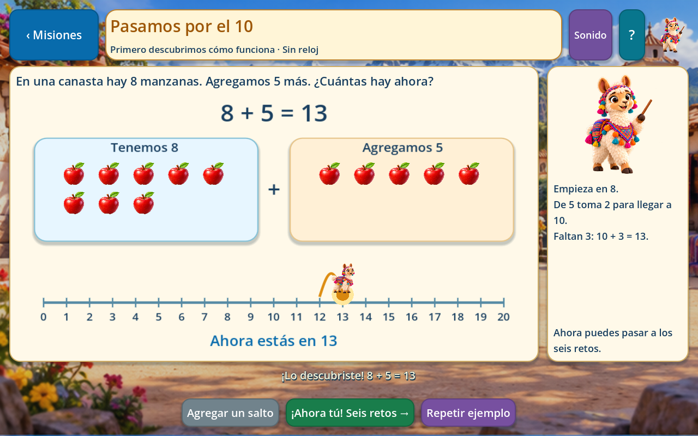
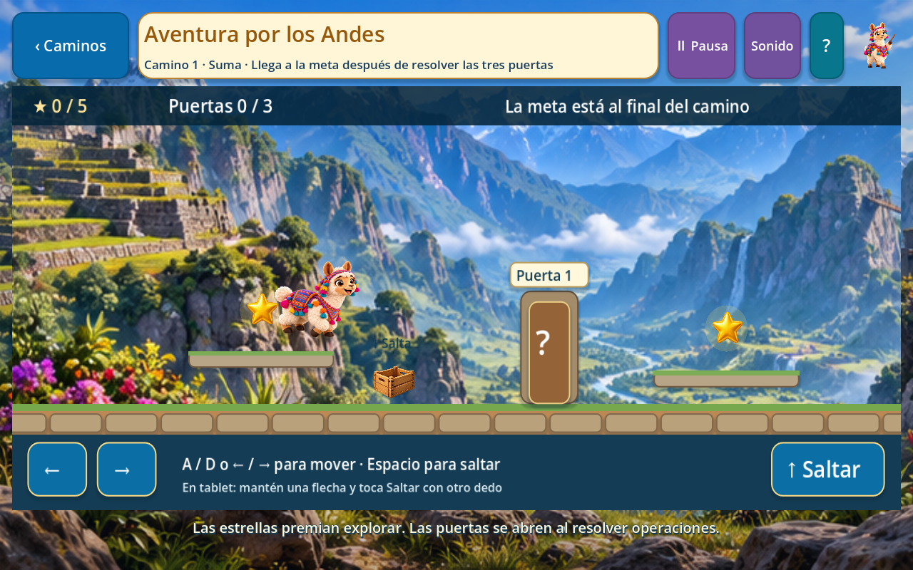
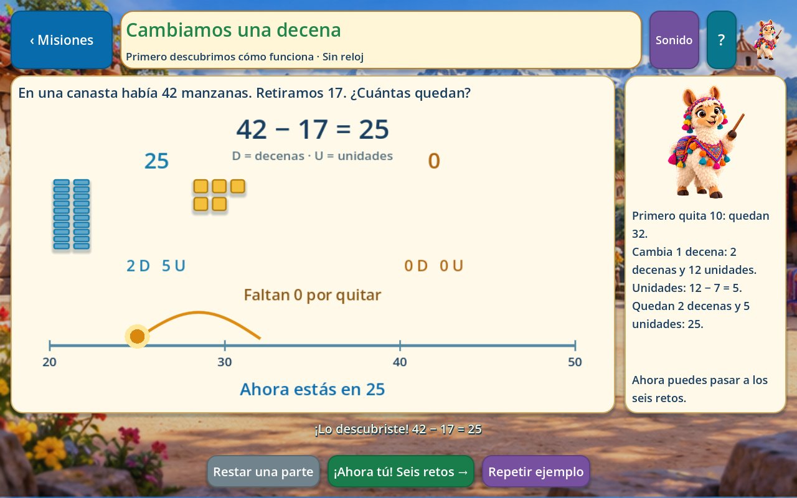
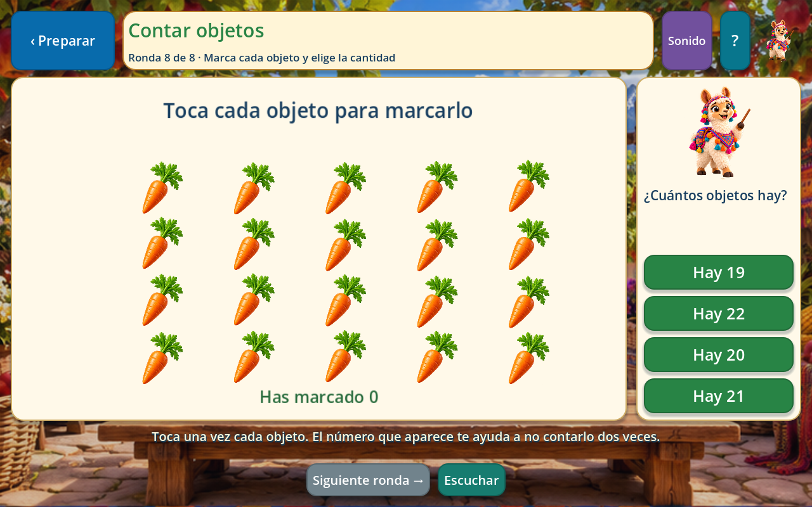
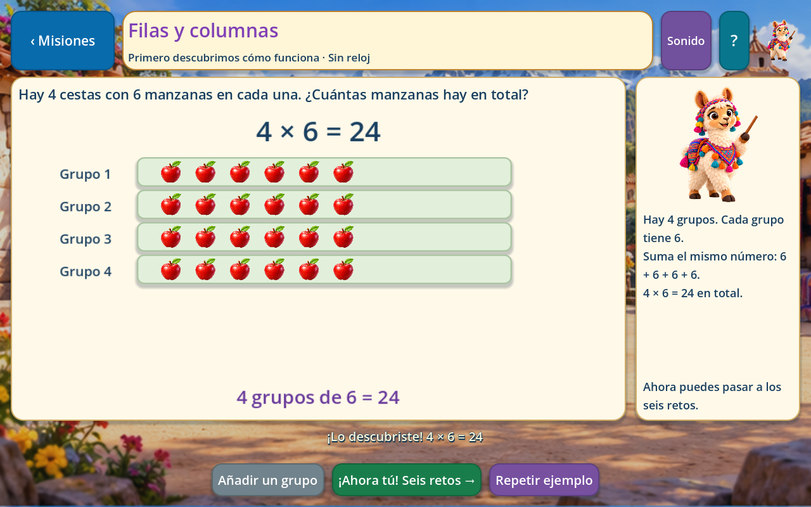
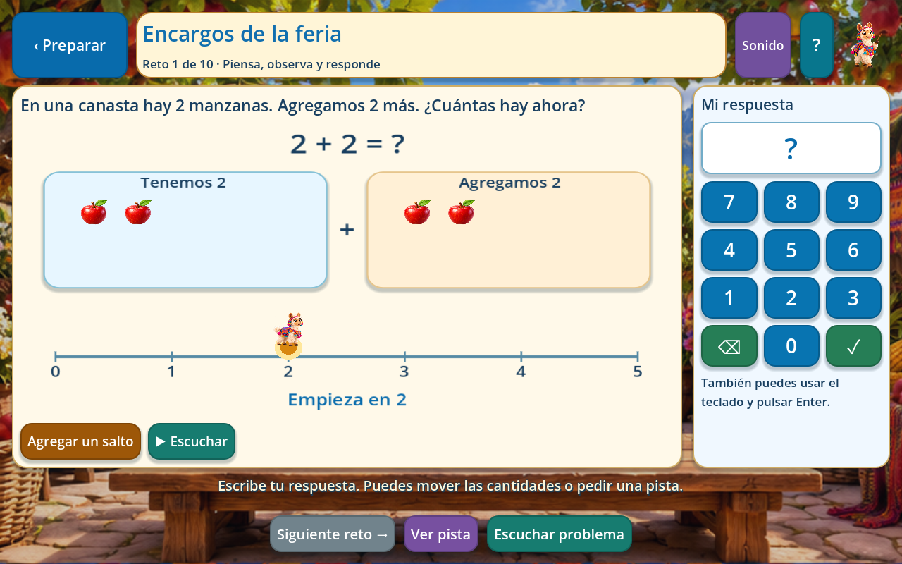
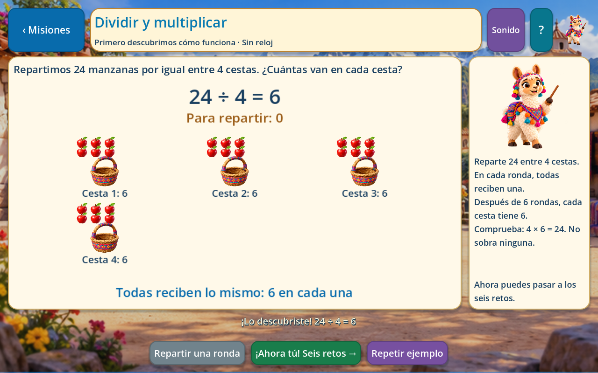
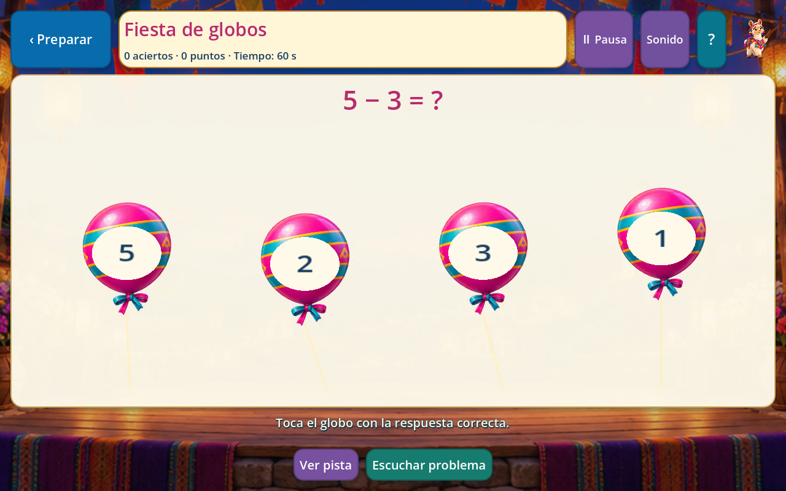

# Matemáticas: ocho actividades jugables

Entrega revisada el 29 de octubre de 2026. Abrir `project.godot`, ejecutar con **F5** y entrar en **Matemáticas** desde el inicio. Las ocho tarjetas abren actividades dentro de Godot. La llama conserva su identidad y su voz peruana; tiene nuevas poses para caminar, correr, saltar y celebrar.

## Qué hace cada tarjeta

| Entrada del menú | Actividad disponible |
| --- | --- |
| Suma | Cuatro misiones. Juntar cantidades, avanzar por la recta y formar decenas al pasar por el diez. |
| Resta | Cuatro misiones. Quitar, retroceder y cambiar una decena por diez unidades cuando hace falta. |
| Multiplicación | Cuatro misiones. Construir grupos iguales y relacionarlos con filas, columnas y tablas. |
| División | Cuatro misiones. Repartir objetos por turnos en canastas y relacionar el reparto con la multiplicación. |
| Contar objetos | Ocho rondas: tocar cada objeto una sola vez, ver su marca y escoger la cantidad. |
| Resolver ejercicios | Diez problemas por partida. Elegir operaciones y dificultad, escribir la respuesta y pedir pistas. |
| Juego por niveles | **Aventura por los Andes**: doce caminos con movimiento, saltos, plataformas, cajas, cinco estrellas y tres puertas matemáticas por camino. |
| Reto rápido | **Fiesta de globos**: tocar el globo que contiene la respuesta. Elegir operaciones, dificultad y 60 segundos, 90 segundos o una partida sin reloj de diez aciertos. |

Suma tiene un recorrido para **aprender la operación**, separado del juego de contar. Por ejemplo, en `8 + 5` la llama avanza hasta diez y después completa los tres que faltan; en `27 + 18` aparecen decenas y unidades. El niño participa en el ejemplo antes de pasar a los seis problemas de la misión. No se presentan las tablas del 1 al 15 como actividad principal.

## Secuencia de aprendizaje

Cada operación tiene cuatro misiones con un ejemplo interactivo y seis problemas narrados: **16 ejemplos y 96 problemas** en total. Los juegos reutilizan este banco; no se anuncian como preguntas adicionales distintas. Los problemas usan cantidades enteras no negativas; las divisiones son exactas y nunca tienen divisor cero.

| Operación | Misión 1 | Misión 2 | Misión 3 | Misión 4 |
| --- | --- | --- | --- | --- |
| Suma | Juntar hasta 5 | Sumar hasta 10 | Pasar por el 10 | Decenas y unidades |
| Resta | Quitar hasta 5 | Restar hasta 10 | Retroceder pasando el 10 | Cambiar una decena |
| Multiplicación | Grupos iguales | Grupos de 2, 5 y 10 | Filas y columnas | Grupos de 7, 8 y 9 |
| División | Repartos pequeños | Repartir por turnos | Relación con multiplicar | Repartos mayores |

La práctica ofrece teclado en pantalla, teclado físico, repetición de la consigna y una pista visual. Un error permite volver a intentar; una pista no completa la misión. No hay reloj en las lecciones.

Los niveles son una aplicación de lo aprendido: hay tres caminos de suma, tres de resta, tres de multiplicación y tres de división. Se desbloquean en orden. Abrir las tres puertas y alcanzar el cofre completa el camino. Las cajas son obstáculos físicos que se superan saltando; las estrellas invitan a explorar. No se pierden vidas por equivocarse en una operación.

## Controles y presentación

- Ratón o toque para tarjetas, objetos, respuestas y teclado numérico.
- En la aventura: **A/D o flechas** para moverse; **Espacio, W o flecha arriba** para saltar. También hay botones táctiles con movimiento y salto simultáneos usando dos dedos.
- **Escape** vuelve o cierra la ventana actual; la aventura incluye pausa.
- Al perder el foco se detienen el movimiento y el reloj del reto. Las pistas y ventanas de pausa también detienen el reloj.
- El sonido comparte volumen y silencio con los menús de Números y Geometría.
- Fondos ilustrados con paneles de lectura claros; cantidades, botones, marcadores y operaciones son elementos de Godot. No son zonas estáticas pegadas sobre una captura.

## Progreso y recompensas

Se mantiene `user://progreso_matematicas.cfg`. Los nuevos datos viven en la sección `aventura_v1`; se conservan las demás secciones y los identificadores anteriores. El guardado utiliza el almacén existente con escritura temporal y copia de recuperación.

Una misión se completa después de resolver sus **seis** problemas. Abrir la tarjeta o recorrer el ejemplo no concede avance. Se guarda la respuesta de cada problema y el uso de pistas o intentos fallidos; se puede salir y continuar. Resolver los seis antes de ver el resultado también se conserva.

Las misiones conceden tres estrellas por seis respuestas al primer intento sin pistas, dos por al menos cuatro y una al completar. Repetir puede mejorar la marca, pero conserva la mejor y no aumenta artificialmente las misiones completadas. El contador del menú representa **16 misiones resueltas**, no dominio educativo demostrado.

Los caminos guardan las puertas abiertas, las estrellas recogidas y los intentos de la puerta pendiente. Al regresar se continúa desde el punto de control. Conceden una estrella al llegar, otra por recoger al menos tres estrellas del paisaje y otra por resolver las tres puertas al primer intento sin pistas.

Los otros tres juegos guardan la mejor puntuación y las mejores estrellas. Contar requiere completar sus ocho rondas; Resolver ejercicios, sus diez problemas. Una respuesta acertada sin pista ni fallo vale diez puntos; después de ayuda o error vale cinco. No se suman récords repetidos como puntos acumulados.

## Funcionamiento sin conexión

Las ocho actividades, ilustraciones, efectos y voces están incluidas en el proyecto. Funcionan dentro de Godot sin abrir un navegador, pedir un micrófono ni llamar a servicios de internet. Esto es independiente del juego HTML de Lenguaje aportado por el compañero, que conserva su implementación.

Se añadieron **155 MP3** en `assets/audio/llama/activities/`: guías de juego, introducciones y problemas. Usan `es-PE-CamilaNeural`, velocidad `-5 %`, coherente con la voz de la llama en los menús. Es síntesis neuronal preparada de antemano; no es una grabación de un actor ni se genera durante la partida. Los hashes de cada audio y guion están en `data/math/activities_voice_provenance.json`.

La generación de ilustraciones y narraciones se hizo durante el desarrollo. No se añadió un tutor generativo, reconocimiento del habla ni sincronización remota del progreso. La adaptación actual es la selección de operación y dificultad por el jugador o el adulto.

## Archivos para continuar en equipo

| Archivo o carpeta | Responsabilidad |
| --- | --- |
| `scenes/math_activity.tscn` | Escena de las actividades internas. |
| `scripts/math/numbers_menu.gd` | Controlador compartido de los tres menús; Matemáticas abre la escena nueva. |
| `scripts/math/math_activity.gd` | Flujo de las ocho actividades, ventanas, respuestas y navegación. |
| `scripts/math/activity_catalog.gd` | Selección de misiones, problemas y niveles. |
| `scripts/math/math_rules.gd` | Resultados, opciones, pasos y explicaciones matemáticas. |
| `scripts/math/math_model.gd` | Recta, decenas, grupos, repartos y conteo táctil. |
| `scripts/math/andes_adventure.gd` | Física, plataformas, obstáculos, puertas y personaje en movimiento. |
| `scripts/math/adventure_map.gd` | Mapa de los doce caminos. |
| `scripts/math/balloon_game.gd` | Globos y selección de respuestas. |
| `scripts/math/math_progress.gd` | Compatibilidad, recuperación, partidas parciales y mejores marcas. |
| `scripts/math/math_audio.gd`, `llama_guide.gd`, `math_ui.gd` | Audio local, animación y componentes compartidos. |
| `tools/build_math_curriculum.py` | Fuente editable de las dieciséis misiones y sus guiones. |
| `data/math/activities.json` | Currículo generado que carga Godot. |
| `tests/math_activities_test.gd` | Recorridos y regresiones de las ocho actividades. |

Para cambiar contenido, editar la fuente en `tools/build_math_curriculum.py` y regenerar los datos. Si cambia el texto narrado, regenerar también su audio. No editar solamente el JSON generado porque una ejecución del constructor lo reemplaza.

```powershell
python tools/build_math_curriculum.py
# Solo si cambiaron los guiones; necesita internet y las dependencias de voz:
./.godot/voice-tools/Scripts/python.exe tools/generate_math_activity_voice.py
python tools/audit_project.py
./tools/validate.ps1 -Godot 'C:/ruta/a/Godot_console.exe'
```

La preparación opcional del entorno de voz está en [Menús matemáticos](MENUS_MATEMATICOS.md). Los compañeros reciben los MP3 ya preparados y no necesitan Python para jugar. El generador omite los audios cuyo archivo y guion siguen vigentes.

## Arte y capturas

Se generaron tres atlas nuevos mediante la herramienta integrada **ImageGen**, sin CLI ni claves externas. Los objetos y la llama conservan transparencia real. El movimiento, las colisiones y las respuestas los controla Godot.

| Recurso final | Contenido |
| --- | --- |
| `assets/ui/math/activities/scenery-atlas.png` | Cuatro fondos en cuadrícula 2 × 2: patio, huerto, valle y fiesta al atardecer. |
| `assets/ui/math/activities/objects-atlas.png` | Ocho objetos en cuadrícula 4 × 2: manzana, zanahoria, maíz, canasta, caja, estrella, globo y cofre. |
| `assets/characters/llama/adventure/run-atlas.png` | Ocho poses en cuadrícula 4 × 2, usando `docs/reference/numbers/llama-reference.jpg` como referencia del personaje. |

Los prompts finales exactos, archivos y firmas están en [Procedencia del arte](reference/mathematics/activities/art-provenance.json). Para el juego se reutiliza también el atlas existente de la llama guía. No se han sustituido las ilustraciones del menú principal.

Capturas reales del juego a 1280 × 800:

| Aprendizaje | Juegos |
| --- | --- |
|  |  |
|  |  |
|  |  |
|  |  |

## Comprobaciones y límites de esta entrega

La validación completa pasó con Godot **4.7.2 Compatibility en Windows**: **1.904 comprobaciones de Godot**, cuatro pruebas de metadatos de narración en Python y auditoría de recursos. Las actividades matemáticas aportan 1.003 comprobaciones. Se recorrieron los 96 problemas, las dieciséis misiones, los doce caminos con física real, pausas, opciones erróneas, pistas, guardado parcial y conservación del guardado anterior.

Se verificaron 176 composiciones de pantalla a **1280 × 800** y otras 176 a **960 × 600**, usando el renderizador real, sin desbordamientos detectados. Se simularon eventos táctiles de dos dedos; falta probar rendimiento, sonido y controles en una **tablet Android física**. No se han preparado instaladores ni perfiles de exportación.

Las implementaciones de Lenguaje y Cuentos se conservaron. Números y Geometría mantienen sus menús actuales; esta entrega completa las ocho actividades internas de Matemáticas. La siguiente revisión con docentes y niños debe comprobar comprensión de consignas, adecuación por edad y transferencia del aprendizaje; las pruebas de software no demuestran por sí solas una mejora educativa.
