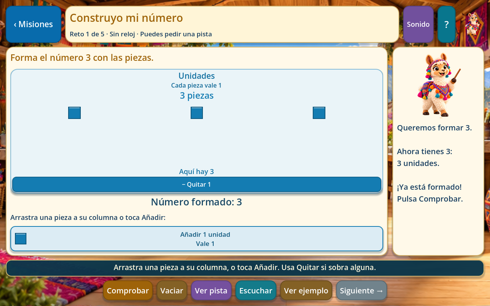
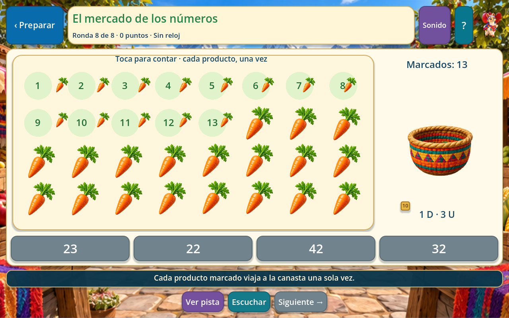
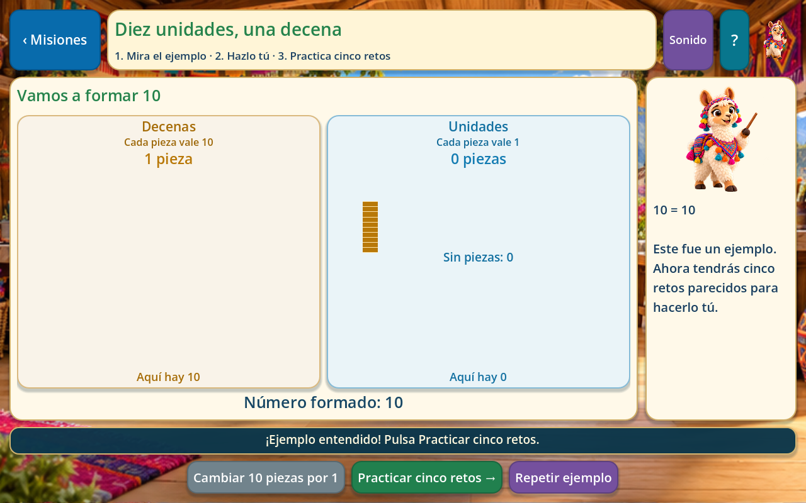
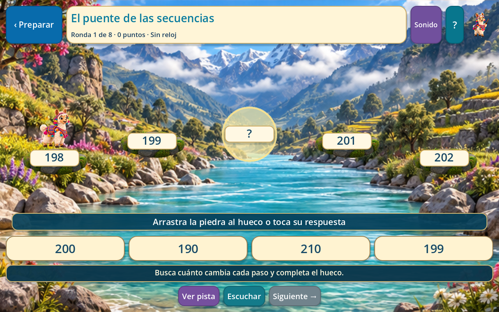
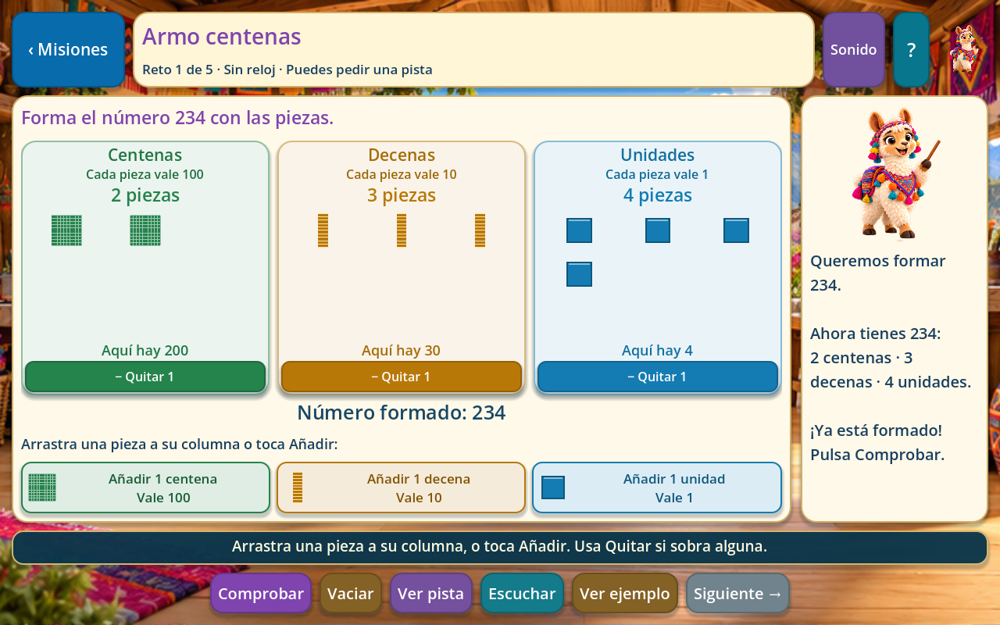
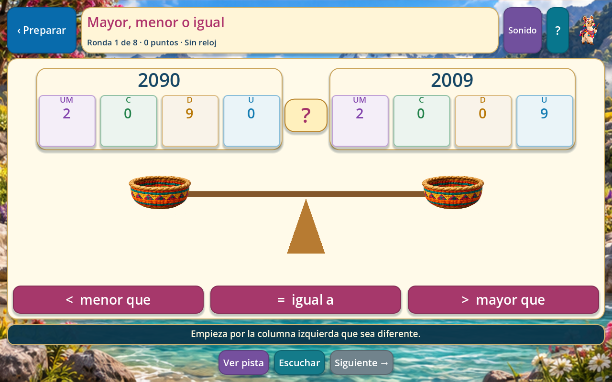
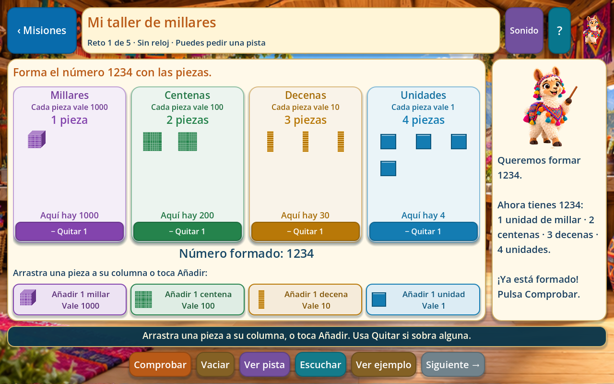
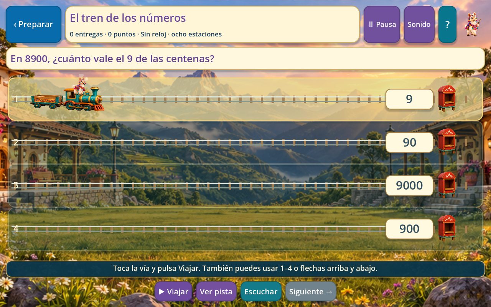

# Números: explorar, construir y jugar

Entrega revisada el 29 de octubre de 2026. Ejecutar el proyecto con **F5 → Números**. Las ocho tarjetas del menú original abren actividades propias dentro de Godot. Se mantienen la llama, su voz y el estilo andino; se añaden un taller, un mercado, un río con puentes y una estación de tren.

## Las ocho entradas

| Entrada | Experiencia disponible | Aprendizaje que se practica |
| --- | --- | --- |
| 1 cifra | Cinco misiones con unidades, cero, nombres, vecinos y orden. | Relacionar cantidad, nombre y cifra del 0 al 9. |
| 2 cifras | Cinco misiones: canjear diez unidades, construir decenas y unidades, conservar ceros, leer y encontrar vecinos. | Comprender los números del 10 al 99 y el valor de cada posición. |
| 3 cifras | Cinco misiones con centenas, canje de diez decenas, ceros intermedios, composición y cambios de centena. | Construir y descomponer del 100 al 999. |
| 4 cifras | Cinco misiones con millares, canje de diez centenas, valor posicional, lectura y orden. | Distinguir números como 1002 y 1020 y trabajar hasta 9999. |
| Contar objetos | **El mercado de los números**: tocar productos que viajan a la canasta, agrupar por diez y seleccionar el total. | Contar cada objeto una vez, relacionar el último conteo con el total y comprender cero. |
| Completar secuencias | **El puente de las secuencias**: arrastrar la piedra que falta o tocar su respuesta. La llama cruza al resolver. | Encontrar una regla constante que aumenta o disminuye y comprobarla en todos los pasos. |
| Mayor, menor o igual | Comparar columnas alineadas y elegir `<`, `=` o `>`. La balanza confirma la comparación. | Comparar desde la posición de mayor valor que sea diferente y reconocer igualdad. |
| Reto rápido | **El tren de los números**: seleccionar una vía y entregar un paquete en la estación de la respuesta correcta. | Aplicar lectura, valor posicional, vecinos y secuencias en retos mezclados. |

Hay **20 misiones con 100 retos**, además de sus ejemplos interactivos; **32 secuencias** y **32 comparaciones** repartidas en cuatro tamaños de número. El mercado tiene ocho rondas: 0, 4, 7, 10, 13, 18, 25 y 32 productos. El tren reutiliza los retos de lectura, composición, posiciones, vecinos y secuencias; sus estaciones no se contabilizan como un banco adicional de preguntas nuevas.

## Cómo se enseña antes de evaluar

Cada misión empieza con un ejemplo del mismo tipo que sus retos: construir, leer, descomponer, buscar vecinos, valorar una cifra u ordenar. Para construir se arrastran piezas reales desde la bandeja a la columna de su color, o se toca Añadir: cubito de una unidad, barra de diez, placa de cien y cubo de mil. Las piezas viajan a su lugar y cambian el número formado. Una columna vacía representa cero.

Los tres ejemplos de canje empiezan con **diez piezas**. El botón cambia diez unidades por una decena, diez decenas por una centena o diez centenas por un millar. Se muestra la cantidad antes y después y la pieza viaja a la columna izquierda para comprobar que sigue siendo la misma. No se puede pasar a los cinco retos antes de resolver el ejemplo.

Los retos alternan construcción, reconocimiento del nombre, valor de una cifra, composición, vecinos y orden. Los números de una, dos, tres y cuatro cifras respetan sus rangos. Los vecinos de cero no producen valores negativos y los de cuatro cifras no pasan de 9999. Las secuencias incluyen pasos descendentes y cruces de decena, centena o millar.

Una respuesta equivocada no concede avance y permite volver a intentar. Las pistas explican la columna o regla que hay que mirar. En las lecciones no hay reloj. Cada misión y cada juego tiene narración incluida y botones para volver a escuchar.

## Controles y ritmo

- **Taller:** arrastrar un bloque desde la bandeja a su columna o tocar Añadir. Se puede devolver un bloque a la bandeja o tocar Quitar. Vaciar permite empezar una construcción de nuevo. Las columnas muestran sus nombres completos, cuántas piezas hay, cuánto vale cada una y qué cantidad aportan. Al comprobar, se indica qué columna tiene piezas de más o de menos. El teclado numérico sigue disponible como alternativa y avanza hacia la siguiente columna. En los retos de orden se toca del menor al mayor y se puede quitar la última elección.
- **Mercado:** tocar cada producto una sola vez; el producto viaja a la canasta y deja su número de conteo. Las opciones se habilitan al terminar de contar. Diez marcados forman un grupo de diez.
- **Puentes:** arrastrar una respuesta al hueco o tocarla. La pista muestra el tamaño y sentido del salto; la animación de la llama confirma que el puente quedó completo.
- **Comparar:** elegir el signo entre los números. La pista destaca la primera columna diferente; la balanza se mueve después de acertar.
- **Tren:** tocar una vía, usar las teclas **1–4** o las flechas **arriba/abajo**, y pulsar **Viajar**. Un envío equivocado regresa y esa estación se descarta; no se pierden vidas.
- **Escape** vuelve o cierra una ventana. El tren incluye pausa y se detiene al perder el foco.

Puentes y comparaciones permiten elegir de una a cuatro cifras y tienen ocho rondas por partida. El tren empieza **sin reloj, con ocho estaciones**; opcionalmente se pueden elegir 90 o 120 segundos. La narración, las pistas, la pausa y la revisión después de acertar detienen ese reloj. Acabar una partida con tiempo requiere resolver al menos una estación para guardar una marca.

## Guardado compatible

Se conserva `user://progreso_numeros.cfg` y se añade la sección `exploracion_v1`. Las misiones usan los identificadores anteriores `one_digit_1` a `four_digits_5`; las demás secciones y los registros desconocidos se conservan. El almacén compartido escribe mediante archivo temporal y guarda una copia de recuperación.

El contador del menú representa **20 misiones completadas**. No se concede avance por abrir tarjetas, escuchar la presentación o visitar el ejemplo. Se requieren las cinco respuestas correctas de cada misión.

Se guardan las respuestas completadas, los intentos fallidos y las pistas. También se conserva una construcción parcial, un canje pendiente de diez piezas o la elección parcial de un orden. Ver ejemplo permite repasar la explicación y volver a la construcción sin perderla. Salir y regresar continúa por el primer reto pendiente. Resolver los cinco y salir antes de ver el resultado tampoco pierde la misión.

Las estrellas de las misiones dependen de los aciertos al primer intento sin pistas: tres por cinco, dos por al menos tres y una al completar. Repetir conserva la mejor marca. En los juegos se guarda la mejor puntuación y las mejores estrellas por actividad y cantidad de cifras; no se suman récords repetidos. Una respuesta sin ayuda ni error vale diez puntos y una resuelta después de ayuda o error vale cinco.

Los minijuegos guardan **resultados de partidas**, no partidas interrumpidas. Mercado, puentes y comparación requieren sus ocho rondas para guardar una marca. Pedir una pista y terminar una misión sigue dando avance: la ayuda forma parte del aprendizaje. Estas marcas registran actividad resuelta, no dominio educativo validado.

## Recursos locales y voces

Las ocho actividades se ejecutan dentro de Godot sin navegador, cuenta, micrófono ni conexión a internet. Los **228 MP3** de `assets/audio/llama/numbers_activities/` usan `es-PE-CamilaNeural` con velocidad `-5 %`, la misma identidad vocal de la llama. Es voz sintética preparada durante el desarrollo; no se solicita una voz nueva al jugar.

`data/numbers/voice_provenance.json` registra las firmas de los audios y los guiones. El volumen y silencio comparten `user://ajustes_numeros.cfg` con Matemáticas y Geometría. Los efectos breves se generan localmente y el cierre detiene voz y efectos.

Los dos atlas nuevos se crearon mediante **ImageGen integrado**, sin CLI. Se copiaron al proyecto y Godot separa sus celdas:

| Archivo final | Contenido |
| --- | --- |
| `assets/ui/numbers/activities/scenery-atlas.png` | Cuatro fondos en cuadrícula 2 × 2: taller, mercado, río y estación. |
| `assets/ui/numbers/activities/props-atlas.png` | Ocho objetos transparentes en cuadrícula 4 × 2: locomotora, vagón, piedra, canasta, buzón, bandera, farol y medalla. |

Se reutilizan el atlas de la llama guía, las ocho poses de movimiento y los productos existentes de Matemáticas. Los bloques de valor posicional, cifras, signos, marcas de conteo y áreas de interacción se dibujan mediante código para que correspondan a las cantidades reales. Las cifras no están incrustadas en las imágenes generadas.

Los [prompts exactos](reference/numbers/activities/art-prompts.json) y la [procedencia con rutas y firmas](reference/numbers/activities/art-provenance.json) permiten continuar el mismo estilo. El archivo original del menú de Números conserva su ilustración.

## Archivos para trabajar en equipo

| Archivo o carpeta | Responsabilidad |
| --- | --- |
| `scenes/number_activity.tscn` | Escena de las ocho actividades internas. |
| `scripts/math/numbers_menu.gd` | Menú compartido: Números abre la escena nueva, Matemáticas conserva la suya y Geometría su presentación. |
| `scripts/numbers/number_activity.gd` | Flujo de misiones, retos, partidas, pistas, ajustes y navegación. |
| `scripts/numbers/number_catalog.gd` | Banco de actividades, selección por cifras y estaciones del tren. |
| `scripts/numbers/number_rules.gd` | Composición, valor posicional, opciones, pistas y comprobación de respuestas. |
| `scripts/numbers/place_board.gd`, `block_token.gd`, `base_ten_piece.gd` | Bloques que se arrastran, bandeja para añadir o devolver piezas, columnas, botones Quitar y canjes animados. |
| `scripts/numbers/market_counter.gd` | Conteo táctil sin duplicación, vuelo de productos y grupos de diez. |
| `scripts/numbers/sequence_bridge.gd`, `bridge_choice.gd` | Huecos, piedras, arrastre y cruce de la llama. |
| `scripts/numbers/comparison_stage.gd` | Columnas alineadas y balanza animada. |
| `scripts/numbers/number_train.gd` | Vías, viaje, devolución y entrega de respuestas. |
| `scripts/numbers/number_progress.gd` | Guardado parcial compatible, validación de resultados y mejores marcas. |
| `scripts/numbers/number_audio.gd`, `number_art.gd` | Audio local y acceso a atlas, reutilizando componentes compartidos. |
| `tools/build_numbers_curriculum.py` | Fuente revisable del currículo y los guiones, incluido el nombre escrito de los números. |
| `data/numbers/` | Datos generados, catálogo de narración y firmas. |
| `tests/number_activities_test.gd` | Recorridos y regresiones de Números. |

Para editar contenido, cambiar la fuente del constructor y regenerar. Si cambia una frase narrada, producir su MP3; el generador omite los archivos vigentes.

```powershell
python tools/build_numbers_curriculum.py
# Solo para preparar voces modificadas; requiere internet:
./.godot/voice-tools/Scripts/python.exe tools/generate_numbers_activity_voice.py
python tools/audit_project.py
./tools/validate.ps1 -Godot 'C:/ruta/a/Godot_console.exe'
```

Para preparar el entorno opcional de voz, ver [Menús matemáticos](MENUS_MATEMATICOS.md). Los compañeros reciben las imágenes y los MP3 incluidos; para jugar no necesitan generar nada.

## Capturas y comprobaciones

Capturas reales del juego:

| Aprender | Jugar |
| --- | --- |
|  |  |
|  |  |
|  |  |
|  |  |

La validación completa pasó en Windows con **Godot 4.7.2 Compatibility**: **3.414 comprobaciones de Godot**, cuatro pruebas de metadatos de audio en Python y la auditoría de rutas, currículo y firmas. Números reúne 1.510 comprobaciones (1.448 funcionales y 62 de arrastre mediante eventos reales de entrada): veinte misiones completas, cien retos, todos los puentes y comparaciones, trenes de una a cuatro cifras, conteo táctil, canjes, opciones incorrectas, pistas, pausa y guardado parcial. También se conserva la validación anterior de Matemáticas, Lenguaje y Cuentos.

La revisión visual cubrió **267 composiciones a 1280 × 800 y otras 267 a 960 × 600**. Queda pendiente comprobar rendimiento, sonido, arrastre y tacto en una **tablet Android física**, además de preparar la exportación. No hay instaladores ni publicación nueva.

Se revisó también Cóndor Guerrero del compañero: su escena propia reúne cámara, mapas, movimiento, animación, sonido y marcador dentro de Godot. Se tomó esa referencia de integración y respuesta visual para crear actividades de números; sus archivos y los demás juegos de Lenguaje no se modificaron. Matemáticas y Cuentos mantienen su contenido. La adecuación por edad y la comprensión de las consignas deben revisarse con docentes y niños; las pruebas de software no son una validación de resultados educativos.
