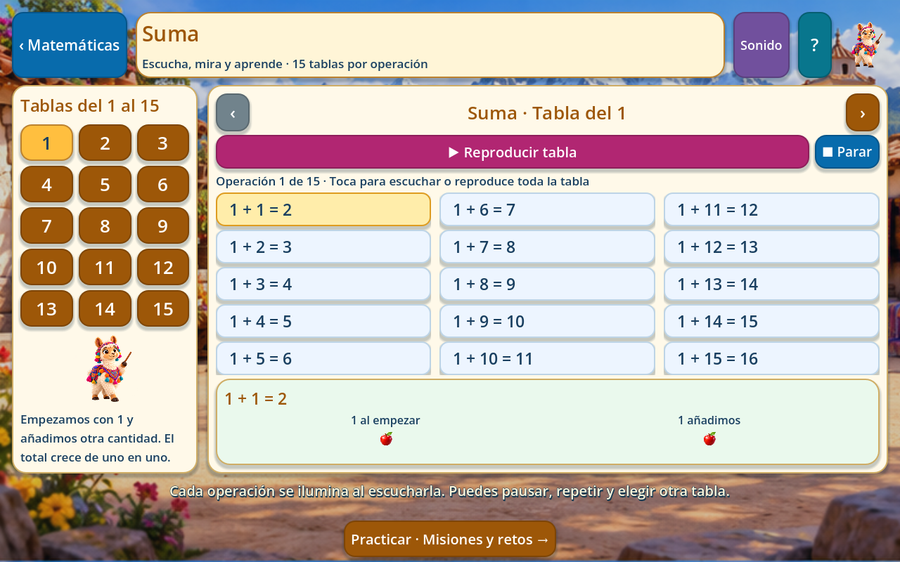
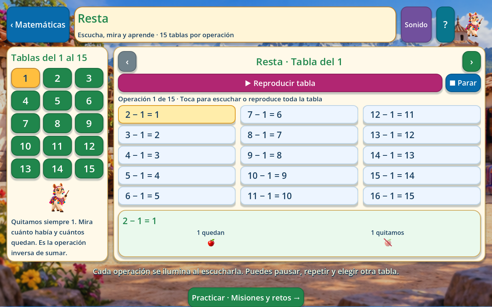
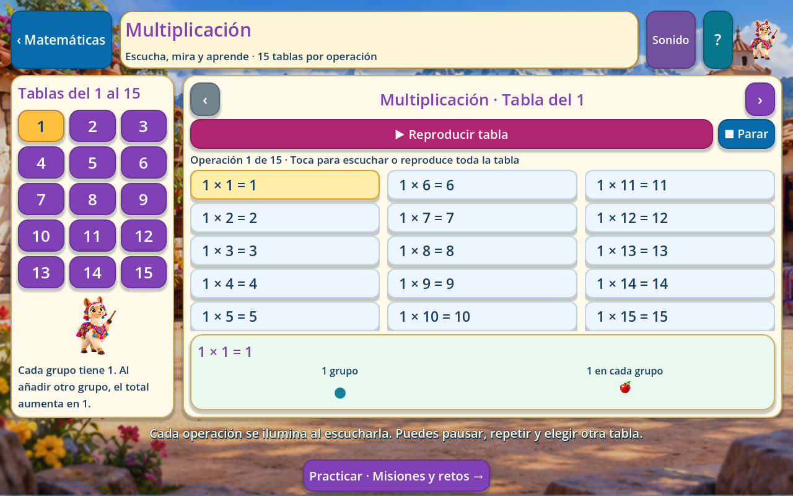
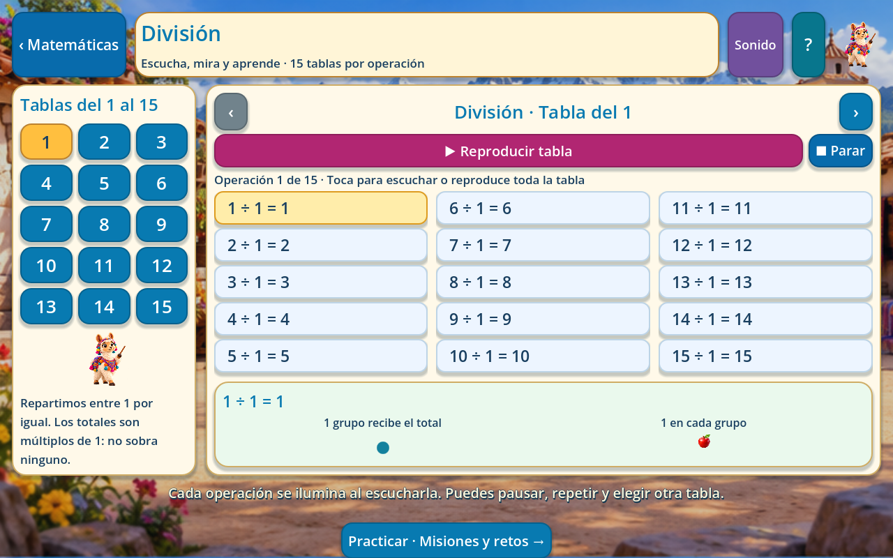

# Tablas de las cuatro operaciones

Actualización del 31 de octubre de 2026. Ejecutar con **F5 → Matemáticas → Suma, Resta, Multiplicación o División**. Cada entrada abre sus tablas del **1 al 15**. El botón **Practicar · Misiones y retos** conserva el acceso a las cuatro misiones de esa operación; desde las misiones se vuelve con **Tablas del 1 al 15**.

## Qué aprende el niño

Cada tabla tiene quince operaciones completas: **60 tablas y 900 ejemplos narrados**. Se muestran en tres columnas, que se leen de arriba abajo y de izquierda a derecha. Los números de la izquierda seleccionan la tabla; las flechas pasan a la anterior o siguiente sin salir de la operación.

| Operación | Qué significa la tabla del 2 | Primera y última operación |
| --- | --- | --- |
| Suma | Empezar con 2 y añadir de 1 a 15. | 2 + 1 = 3; 2 + 15 = 17 |
| Resta | Quitar siempre 2 a una cantidad mayor. Se relaciona con la suma y se evitan negativos. | 3 − 2 = 1; 17 − 2 = 15 |
| Multiplicación | Cada grupo tiene 2; aumentar de uno a quince grupos. | 2 × 1 = 2; 2 × 15 = 30 |
| División | Repartir entre 2, usando sus múltiplos para que no sobre nada. | 2 ÷ 2 = 1; 30 ÷ 2 = 15 |

No se presenta una resta como `2 − 15` ni una división no exacta como `2 ÷ 15`. El número de la tabla identifica lo que se quita o entre cuántos se reparte, respectivamente. Las misiones originales siguen enseñando las operaciones con objetos que se mueven, recta, decenas y repartos.

Al tocar una operación se ilumina, se escucha la frase completa y aparece su representación. Suma y resta muestran las cantidades que se añaden, quedan o se quitan. Multiplicación y división muestran el número de grupos y una muestra de lo que hay **en cada grupo**; evitan llenar la pantalla con 225 objetos diminutos.

## Voz y controles

- **Reproducir tabla:** empieza en la primera operación y lee las quince en orden. La selección avanza cuando termina realmente el audio, con una breve separación entre operaciones.
- **Pausar / Continuar:** conserva la posición dentro de la frase, sin avanzar mientras está pausada.
- **Parar:** detiene la lectura. Volver a reproducir comienza desde la primera operación.
- Tocar una operación interrumpe la lectura automática y lee únicamente esa fila.
- Cambiar de tabla, abrir ayuda o sonido, salir o poner la aplicación en segundo plano detiene la narración.
- Al terminar se puede repetir. Leer o escuchar no concede estrellas ni modifica las puntuaciones de las misiones.

Las 900 frases son MP3 completos incluidos en `assets/audio/llama/tables/`. Mantienen la voz de la llama, `es-PE-CamilaNeural`, a velocidad `-5 %`. No se ensamblan palabras sueltas ni se solicita una voz durante la partida. La generación inicial requiere internet; jugar y escuchar las tablas funciona sin conexión.

## Archivos para el equipo

| Archivo | Responsabilidad |
| --- | --- |
| `scripts/math/table_lesson.gd` | Selección, filas, sincronización, pausa y repetición. |
| `scripts/math/table_model.gd` | Representación de cantidades y grupos. |
| `scripts/math/operation_tables.gd` | Consulta del catálogo y explicaciones. |
| `data/math/operation_tables.json` | Las 60 tablas con sus resultados. |
| `data/math/tables_voice_lines.json` | Texto exacto de cada una de las 900 frases. |
| `data/math/tables_voice_provenance.json` | Voz y firmas del texto y audio. |
| `tools/build_operation_tables.py` | Generación reproducible del catálogo y guion. |
| `tools/generate_tables_voice.py` | Generación reanudable de los MP3 completos. |
| `tools/audit_operation_tables.py` | Comprueba cálculos, guiones y correspondencia de archivos. |
| `tests/operation_tables_test.gd` | Pruebas de resultados, audio, navegación y controles. |

Para regenerar tras cambiar el contenido:

```powershell
python tools/build_operation_tables.py
./.godot/voice-tools/Scripts/python.exe tools/generate_tables_voice.py
```

La herramienta de voz usa las dependencias de `tools/voice-requirements.txt`. Los demás integrantes solo necesitan los archivos incluidos y esperar la importación normal de Godot.

## Capturas del juego

| Suma | Resta |
| --- | --- |
|  |  |

| Multiplicación | División |
| --- | --- |
|  |  |

## Comprobaciones

La auditoría verifica las 900 igualdades y sus archivos de voz completos. Las **3.240 comprobaciones nuevas** de Godot decodifican cada MP3 y revisan la secuencia, la pausa, el cambio de tabla, los límites, el silencio, la salida y que no se modifique el progreso anterior. Incluyen clics reales y el avance producido al terminar de reproducir una frase. Las comprobaciones visuales recorren **68 composiciones a 1280 × 800 y otras 68 a 960 × 600**, con las 60 tablas y el acceso a las misiones. La prueba en tablet Android física sigue pendiente.
